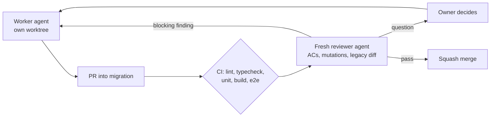

# ascrum-migration

A 2013-era AngularJS 1.2 reference app (AScrum, from the book _Mastering Web Application Development with AngularJS_), migrated to React 19 and TypeScript by [Claude Code](https://claude.com/claude-code) agents working under one human owner's direction. The code is half of the deliverable; the other half is the workflow that produced it: a written spec as the contract, parallel agents in git worktrees, independent reviewer agents, hard CI gates, and logs that record what went wrong as plainly as what went right.

**Status:** all phases done. Phase 0 (discovery), Phase 1 (spec), Phase 2 (harness), Phase 3 (parallel conversion) and Phase 4 (this case study). See [`MIGRATION.md`](MIGRATION.md).

**Live demo:** <https://timothyjeffcoat.github.io/ascrum-migration/>. It runs entirely in your browser: the API is a stub served by [MSW](https://mswjs.io/), and there is no real backend. Data resets on every page load.

**Demo logins:** `admin@abc.com` / `changeme` (admin, as in the original). `po@ascrum.test`, `sm@ascrum.test`, `dev1@ascrum.test`, `dev2@ascrum.test` and `outsider@ascrum.test` (password `demo`) each have a different role on the demo projects.

---

## Results at a glance

Every number below is measured; the [number sources](#number-sources) section at the end says where each one comes from.

| Measure | Value |
| --- | --- |
| Legacy app | 2,290 lines (40 JS files, 17 templates) |
| Port, app code (`web/src`, tests excluded) | 3,762 lines of TypeScript/TSX |
| Port, test code (`web/src`) | 5,397 lines in 39 files |
| Acceptance criteria | 76, plus 15 for the API stub; each has a test named after its id |
| Defects found in the legacy app | 21: 16 fixed, 5 kept on purpose |
| Legacy unit tests carried over | 103 of 133 (60 ported, 43 adapted); 10 n/a, 20 tested dead code |
| Tests on the final commit | 402 unit tests in 41 files, 37 Playwright tests; CI green on all 5 jobs |
| Reviewer mutations, first review of each cluster | 135 deliberate breakages; tests caught 125 |
| Deviations logged | 37: 1 blocking, 36 non-blocking; none open |
| Live bugs found by the independent legacy audits | 3, after every gate had passed |
| Owner decisions | 33 discovery answers, 15 spec sign-offs, 15 later answers, 6 spec amendments |
| Pull requests before this write-up | 24: 23 merged, 1 closed unmerged (a CI experiment); this case study is #25 |
| Calendar time | 2026-11-20 12:08 to 2026-11-22 12:02 (local time), first Phase 0 commit to the last code merge (#24) |

What these numbers do not say: tests passed in this repo's CI, against a stub. Nothing here has run in production.

---

## How the workflow ran

**Roles.** The **owner** is the human. The **orchestrator** is the main Claude Code session working with the owner: it ran discovery, wrote the spec and the harness, launched the other agents, and relayed questions. **Workers** are fresh sessions, each converting one cluster of screens in its own git worktree. **Reviewers** are fresh sessions that never wrote the code they review. Every agent session followed [`CLAUDE.md`](CLAUDE.md).

**Phases.**

| Phase | Output | Gate to leave it |
| --- | --- | --- |
| 0. Discovery | [`spec/inventory.md`](spec/inventory.md), 33 questions in [`spec/questions.md`](spec/questions.md) | no design, no code; every fork in the road is a question |
| 1. Spec | [`spec/conversion-spec.md`](spec/conversion-spec.md) | an independent review ([25 findings, 9 blocking](spec/reviews/spec-review-1.md)), then owner sign-off |
| 2. Harness | scaffold, API stub, test helpers, CI, Pages deploy | reviewer sign-off ([`phase-2-review.md`](spec/reviews/phase-2-review.md)), CI green, demo live |
| 3. Conversion | six clusters, in waves | every cluster `merged` in [`MIGRATION.md`](MIGRATION.md) |
| 4. Case study | this README, the [deviations summary](spec/deviations.md#summary) | — |

**Waves.** Cluster 0 (foundation: HTTP client, auth, forms hook, shell) went first and alone. Wave A (admin users, admin projects, projects and backlog) ran three workers in parallel. Wave B (sprints and tasks, dashboard) started only after wave A merged. The spec assigned each cluster the paths it owned, so parallel workers never edited the same file.

**The loop for each cluster:**



**Gates.** Five CI jobs (lint, typecheck, unit, build, e2e) are required checks on `migration`. The rules in `CLAUDE.md` that are easy to break by accident are enforced by tools, not prose: inline lint overrides are off, `.only`/`.skip`/`.todo` and `@ts-*` comments are lint errors, warnings fail lint, and Playwright forbids `.only`. A hook ([`.claude/hooks/metrics.sh`](.claude/hooks/metrics.sh)) appends every gate run, commit, PR and agent launch to [`spec/metrics.jsonl`](spec/metrics.jsonl), so the numbers don't depend on agents reporting their own results.

**Reviews.** A reviewer checked each acceptance criterion against the code _and_ a test named after it, then tried to break the code: small hand-written mutations, each one expected to turn some test red. After cluster 0, reviewers were expected to write their own mutation lists rather than rerun the worker's.

**The owner's role.** The owner answered 33 discovery questions (29 by accepting the recommendation), signed off 15 decisions the spec made on its own, and answered later questions as they came up, usually several at once, each with a recommendation attached. Six of those answers became spec amendments (§0.2 P1–P6). One later question (Q-fix-forms-1) was answered by the orchestrator, applying a rule the owner had already set. The owner also delegated merging to the reviewer once CI was green; in practice the orchestrator held the wave merges and merged them one at a time (see [What went wrong](#what-went-wrong)).

---

## What the gates caught

- **A spec that would have deadlocked.** The independent spec review found that with the login modal inside the router, reloading an admin page while logged out would wait forever for a modal that never mounts. It was fixed in spec rev 2, before any worker started. Most of the 25 findings were about how agents coordinate (unowned files, a shared questions file across isolated worktrees), not about React.
- **A test that could not fail.** On cluster 0, the reviewer's 20th mutation made a logged-out click on the brand do nothing, and all 181 unit tests stayed green: the test started and ended on the same page. That was the only blocking finding of the project (DEV-foundation-01). The fix changed one test file, and a re-review reran the same mutation and watched it fail.
- **The same blind spot twice.** Two workers, given the same brief in parallel, both tested the admin guard on the list route only, because the acceptance criterion named only that route. Removing the guards on "new" and "edit" left every test green on both clusters (DEV-admin-projects-01, DEV-admin-users-01). The finding was about the brief; wave B workers were briefed with it, and neither wave B PR had a finding in that area.
- **A contradiction inside the spec.** Two approved rules combined so that an admin could not save a password-only change. The worker built the spec as written, flagged the conflict, and proposed a fix; the owner chose it (P2).
- **Stale data on screen.** Reviewers probing edge cases found two places where a form showed one value while holding another: a team pick that had become the Product Owner (P3), and a task whose backlog item or assignee was no longer valid, which read "-- unassigned --" while Save kept the old id (P5).
- **Wrong numbers.** One worker's log claimed 215 unit tests; CI and the reviewer measured 202 (DEV-admin-projects-03). Checking it showed the metrics hook had never recorded `pnpm verify`, so the claim couldn't be checked against the ledger; the hook was fixed.
- **Tools catching tools.** The type checker caught a renamed MSW option that had silently disabled the "fail on unmocked request" safety net. Lint caught a dead line left by an edit.

## What the gates missed

Gates check what the spec says. They cannot notice what the spec forgot.

- **Enter in the project form reloaded the page** and threw away unsaved edits. The form had no submit handler, and its only text field was Name.
- **Enter in the login window no longer signed in.** A convention in `CLAUDE.md` ("every button in a form is `type=button`") caused it.
- **Text fields were not trimmed.** AngularJS trims every text input by default; the port did not, so a sprint named with three spaces passed `required` and was saved.
- **A double click on Save creates two records.** Legacy did the same; nobody had written it down.

All four passed lint, typecheck, unit tests, e2e, CI and a spec-based review. The independent audits below found them.

---

## The independent legacy audits

The owner asked a fair question: how can they review a port of an app they don't understand? Every check here (spec, tests, reviews) traced back to one agent's reading of the old code. If that reading was wrong or incomplete, every gate downstream would inherit the gap and stay green.

So, once per wave, a fresh agent read `legacy/` with the inventory, spec and port off-limits, and **committed that blind reading before comparing it** with anything, so the history shows which came first.

| Audit | Claims | Agree | Intentional difference | Findings | Live in the shipped app |
| --- | --- | --- | --- | --- | --- |
| [Wave A screens](spec/reviews/legacy-audit-wave-a.md) | 53 | 36 | 14 | 4 | Enter reloads the project form; Enter doesn't sign in |
| [Wave B screens](spec/reviews/legacy-audit-wave-b.md) | 59 | 44 | 14 | 3 | untrimmed text; double-click Save (as legacy) |

Neither audit found the inventory describing a screen wrongly. One finding corrected a wrong note in the spec (DSC-3); the rest were things nobody had written down. Each live bug was reproduced on the built app, became a spec rule (P4 for Enter, P6 for trimming), was fixed with tests that fail without the fix, and went through its own reviewer with mutations (DEV-audit-01..08 in [`spec/deviations.md`](spec/deviations.md)). The double-click was kept on purpose, by the owner's decision, as legacy behavior.

**The lesson:** a review against the spec verifies the spec was followed. It takes a second, independent reading of the original to find out whether the spec was complete.

---

## The flaky test hunt (DEV-foundation-06)

During wave A, the logout test (AC-AUTH-07) failed on CI three times in one day, once on `migration` itself, while passing every local run (18 of 18, some on a deliberately loaded CPU). A rerun turned it green each time.

The orchestrator did not stop at the rerun:

1. A first theory (the test clicks a header button that React then replaces) was probed locally and appeared ruled out: the button was live in 135 of 135 runs.
2. The test was changed to fail at the step that stalls, so the next failure would say where.
3. Since the failure lived on CI, the experiment moved there: a throwaway draft PR (#13, closed unmerged) ran the logout flow 40 times with diagnostics. One run stalled: no request sent, user still signed in, clicked button detached from the page.
4. The first theory had been right. `router.state.initialized` flips before React commits the real shell, so the test sometimes clicked the first-load copy of the header just before it was replaced. A fast laptop never loses that race.

The fix was a shared `waitForShell()` test helper (in [`web/src/test/renderRoute.tsx`](web/src/test/renderRoute.tsx)) plus a `CLAUDE.md` rule for wave B. With it, the probe passed 240 of 240 runs on CI. The app was never wrong. The test still mattered: a test that fails one time in 40 teaches people to press "rerun", and that is how real failures get waved through.

---

## What went wrong

Mistakes are recorded in [`spec/journal.md`](spec/journal.md) and [`spec/deviations.md`](spec/deviations.md). A selection:

**Orchestrator (the main session)**

- **A commit message that lied, twice.** "Remove committed secrets" contained the folder move but not the edits (a `sed` ran after staging); later a fix commit listed a file it did not contain. `git diff --stat` caught the first before push and the commit was amended; a follow-up commit fixed the second.
- **A test that passed for the wrong reason.** To prove a stylesheet setting mattered, the orchestrator removed it and reran the test, which passed: Playwright was serving the previous build. `pnpm e2e` now always builds first.
- **The metrics undercounted failures.** The orchestrator piped gate runs through `tail`, which exits 0, so the hook logged them as passes. The ledger showed 1 failed gate run out of 15 in Phase 2; the stylesheet alone had failed to compile 6 times. `CLAUDE.md` now requires unpiped gate runs. A worker later made the same slip (`pnpm verify > log; echo EXIT=$?`) and reported it in its worklog.
- **The honesty tool leaked.** The metrics ledger recorded absolute local paths and, in one row, the first 8 characters of a dead API key. The Phase 2 reviewer found it. When the orchestrator then tried to scrub the ledger, Claude Code's permission system blocked it as tampering with an audit record until the owner approved. The scrub's own check then found a second leak the first fix had missed.
- **The spec was written from memory of the legacy code.** The spec review found three places where it misdescribed the old code, and one quietly redefined metric (N of 113 tests instead of the agreed N of 133).
- **Process slips during merges:** stashing the ledger across a branch switch collided with the hook (rows merged back by hand, none lost); running Prettier over root Markdown tables made them unreadable (reverted); one conflict resolution left a duplicate deviation row (caught by listing ids); two journal headings carried the UTC date instead of the local one.
- **A departure from the agreed process, on purpose.** The spec lets the reviewer merge once CI is green. For cluster 0 and both waves, the orchestrator held the merges until the owner had answered open questions, and merged one PR at a time. This is recorded in the journal rather than hidden.

**Workers and reviewers**

- A worker reported 27 test files and 215 tests; the branch had 26 and 202.
- A worker's own mutation check "passed" because the mutation never applied; it noticed only because `diff` printed nothing, and logged it.
- Tests that looked like checks but could not fail: the brand-click test (blocking), and a dashboard assertion that a table sits inside a `div`, which is always true on a web page.
- One agent mistake reached the shipped app: the "every button is `type=button`" convention broke Enter in the login window (above).

**Still open:** nothing. The last open item, DEV-admin-users-02 (a missing assertion for one half of the edit-time password rule), sat unnoticed from the wave A review until the case-study writer counted open rows; it was closed in the same PR.

---

## Lessons for engineering managers

1. **Buy decisions early, in bulk.** Discovery produced 33 questions before any design. 29 answers were "follow the recommendation". The human's work became a short list of real decisions, each with a recommendation attached, instead of a stream of interruptions.
2. **Put rules in tools, not prompts.** "Never skip a test" in a prompt is a request. A lint rule that fails the build on `.skip` is a wall. The rules that are easy to break by accident were made mechanical, and the Phase 2 review still found five forms of skipped test the first lint rule missed.
3. **Review by breaking things.** Reading tests tells you they exist. Breaking the code tells you they bite. The only blocking finding of the project was a test that could not fail, found by the reviewer's 20th deliberate breakage.
4. **Audit the source of truth, not just the work.** Every gate was green while three user-visible bugs were live. The gates checked the spec; only a blind second reading of the original showed what the spec had left out.
5. **When two agents make the same mistake, fix the brief.** Two parallel workers missed the same guard test because the acceptance criterion named only one route. The next wave, briefed with that finding, didn't repeat it.
6. **Measure with instruments, and review the instruments.** Agents misreport their own numbers, so a hook records them. The hook in turn undercounted failures, missed a command, and leaked local paths. Each was found by checking the measurement, not trusting it.

---

## Repo map

| Path | What it is |
| --- | --- |
| [`web/`](web/) | The React 19 app (`src/`), the API stub (`stub/`), Playwright tests (`e2e/`) |
| [`web/src/features/`](web/src/features/) | One folder per converted screen group |
| [`legacy/`](legacy/) | The original AngularJS app and Express server, reference only, never modified |
| [`spec/conversion-spec.md`](spec/conversion-spec.md) | The contract: stack, mapping, defect dispositions, workflow, acceptance criteria, amendments P1–P6 |
| [`spec/inventory.md`](spec/inventory.md) | Discovery: everything the legacy app does, and its defects |
| [`spec/questions.md`](spec/questions.md), [`spec/questions/`](spec/questions/) | Discovery questions and the owner's answers; later questions per cluster |
| [`spec/reviews/`](spec/reviews/) | Spec review, Phase 2 review, legacy audits for waves A and B |
| [`spec/worklogs/`](spec/worklogs/) | One log per worker task, including the legacy test-porting tables |
| [`spec/deviations.md`](spec/deviations.md) | Every difference, gap or mistake a review, CI, audit or worker found, with its resolution |
| [`spec/journal.md`](spec/journal.md) | The running narrative: decisions, mistakes, measured metrics |
| [`spec/metrics.jsonl`](spec/metrics.jsonl) | Machine-recorded ledger of gate runs, commits, PRs and agent launches |
| [`MIGRATION.md`](MIGRATION.md) | Phase gates and cluster status |
| [`CLAUDE.md`](CLAUDE.md) | The rules every agent session followed |
| [`.github/workflows/`](.github/workflows/) | CI (five gates) and the Pages deploy |

---

## Run it

Node 24 (from `web/.nvmrc`) and pnpm (via corepack). Everything lives in `web/`.

```sh
cd web && corepack enable && pnpm install
pnpm dev          # http://localhost:5173, API stub on :3001 behind Vite's proxy
pnpm dev:msw      # the same, with the stub in the browser (what the public demo does)
pnpm verify       # every gate CI runs: lint, typecheck, unit tests, build, e2e
```

There is no real backend. MongoLab, the original database host, shut down in 2020. A small stub reproduces the legacy server's contract, quirks included (the JSON-hijack prefix, the XSRF handshake), with deterministic demo data.

---

## Credits and history

The original app is [angular-app/angular-app](https://github.com/angular-app/angular-app) by Pawel Kozlowski and Peter Bacon Darwin (MIT, see [LICENSE](LICENSE)), written for their book [_Mastering Web Application Development with AngularJS_](http://goo.gl/gKEsIo). Its original README is on the [`master`](https://github.com/timothyjeffcoat/ascrum-migration/blob/master/README.md) branch, which is kept as the untouched legacy snapshot; its setup steps no longer work.

The upstream history (and so this repo's) contains a long-dead MongoLab API key and a self-signed TLS private key committed by the original project. They are removed from the current tree. History is not rewritten, so the link to upstream commits stays intact.

The conversion was done by Claude Code agents under the direction of the repo owner, who made the product and scope decisions recorded in [`spec/questions.md`](spec/questions.md) and [`spec/questions/`](spec/questions/).

---

## Number sources

Each figure in [Results at a glance](#results-at-a-glance), with where to check it.

| Figure | Source |
| --- | --- |
| Legacy 2,290 lines (40 JS + 17 templates) | `spec/conversion-spec.md` §10 (measured with `wc -l`) |
| Port 3,762 app lines; 5,397 test lines in 39 files | `find web/src -name '*.ts' -o -name '*.tsx'`, excluding `*.test.ts(x)` and `src/test/`, piped to `wc -l`; the same for test files |
| 76 ACs + 15 stub ACs | `spec/conversion-spec.md` §12.0–§12.6 |
| 21 defects, 16 fixed, 5 preserved | `spec/conversion-spec.md` §6 (20 from `spec/inventory.md` §13, D21 found while writing the spec) |
| 103 of 133 legacy tests; 60 / 43 / 10 / 20 | worklog tables in `spec/worklogs/{foundation,admin-users,admin-projects,projects}.md`; 20 dead from §9 (17 + 3) |
| 402 unit tests, 41 files, 37 Playwright, 5 jobs | CI run 45058504468 on `8e22769` (`gh run view 45058504468 --log`) |
| 135 mutations, 125 caught | first reviews in `spec/journal.md`: cluster 0 20/19, cluster 2 17/14, cluster 3 14/14, cluster 1 23/19, cluster 5 27/25, cluster 4 34/34 (unit) |
| 37 deviations, 1 blocking, 0 open | `spec/deviations.md` (see its Summary) |
| 3 live bugs from audits | `spec/reviews/legacy-audit-wave-a.md` (DSC-1, DSC-2), `legacy-audit-wave-b.md` (DSC-B-1) |
| 33 / 15 / 15 / 6 owner decisions | `spec/questions.md` (Q-A1..Q-F4), spec §0.1 (S1–S15), the 16 question ids in `spec/questions/*.md` minus Q-fix-forms-1 (answered by the orchestrator under the owner's P4 rule), spec §0.2 (P1–P6) |
| 24 PRs, 23 merged, 1 closed | `gh pr list --state all` |
| Calendar time | `git log` on `06a501d` and `8e22769` |
